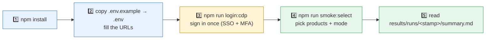
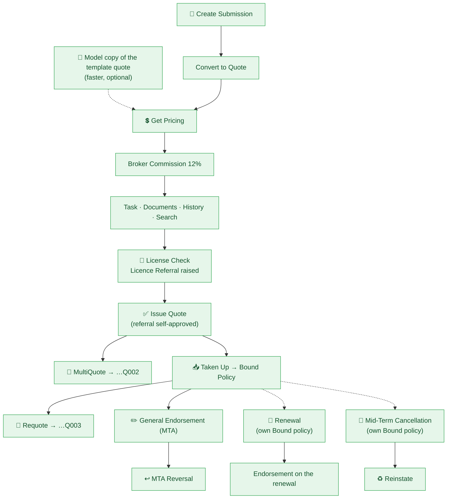
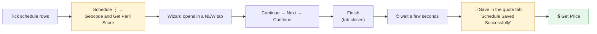
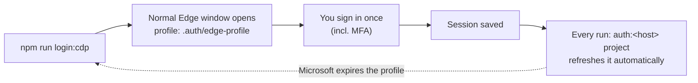

<div align="center">

# 🔥 UI Smoke Tests

### One command to smoke-test **PI · CMBC · PPP · MTP · Fleet** after every deployment


*Developed by **Deena Yadav***

[⚡ Quick start](#quick-start) · [🧭 Which command?](#which-command) · [🔀 Sequential vs parallel](#seq-par) · [🗺️ What is covered](#covered) · [🔁 Resuming](#resume) · [🔐 Sign-in](#signin) · [🩺 Troubleshooting](#troubleshooting) · [🧱 Layout](#layout)

</div>

---

## 📦 What is this?

A **Playwright + TypeScript** suite that replaces the manual post-deployment UI smoke check.
It drives the real AdvantageGo Underwriting screens: it creates quotes, prices, issues, takes up, endorses, renews,
cancels, reverses… and records every contract it creates.

| Product | Status | What runs |
|:--|:--:|:--|
| **PI** | ✅ Full flows | Quote → Policy → Endorsement → Reversal → Renewal → Cancellation |
| **CMBC** | ✅ Full flows | Quote (PDBI + Liability + schedule) → Policy → Endorsement → Renewal → Cancellation |
| **PPP** | 🟡 Page checks | Generic "does every page load?" checks once its URL is set |
| **MTP** | 🟡 Page checks | same |
| **Fleet** | 🟡 Page checks | same |

> Every product lives in **its own folder** and shares no flow code with the others, so a change to one product can never break another.

---

<a id="quick-start"></a>

## ⚡ Quick start



```bash
npm install
npx playwright install chromium     # or set BROWSER_CHANNEL=msedge to use the installed Edge
cp .env.example .env                # then fill in the URLs (and credentials if not SSO)
npm run login:cdp                   # a normal Edge window opens: sign in once, MFA included
npm run smoke:select                # interactive: which products? one after another, or together?
```

> 💡 A product with no `<KEY>_URL` in `.env` is **skipped, not failed**.
> Several environments? Create `.env.qa`, `.env.uat`… and run with `TEST_ENV=qa`.

---

<a id="which-command"></a>

## 🧭 Which command do I run?

| I want to… | Run this |
|:--|:--|
| 🎛️ **Be asked** which products and which mode | `npm run smoke:select` |
| 🅿️ Run **PI only** | `npm run smoke:pi` |
| 🏢 Run **CMBC only** | `npm run smoke:cmbc` |
| ➡️ Run **PI then CMBC**, one after another *(safe default)* | `npm run smoke -- --products pi,cmbc` |
| ⚡ Run **PI and CMBC at the same time** | `npm run smoke -- --products pi,cmbc --mode parallel` |
| 🌍 Run **every configured product**, one after another | `npm run smoke` |
| 🌍⚡ Run **every configured product at once** | `npm run smoke:par` |
| 👀 **Watch the browser** (recommended while debugging) | `npm run smoke -- --products pi --headed --workers=1` |
| 🎯 Run **one test** by name | `npm run smoke -- --products pi -g "Get Pricing"` |
| 🔑 Only **check / refresh the saved sign-in** | `npm run auth` |
| 📋 **List** products and whether each is configured | `npm run smoke:list` |
| 🧪 **Preview** what would run, run nothing | `npm run smoke -- --products pi,cmbc --dry-run` |
| 🛑 **Stop at the first failing product** (sequential) | add `--fail-fast` |
| ⏭️ **Skip** the sign-in check | add `--no-auth` *(see the warning in [Troubleshooting](#troubleshooting))* |
| 🧱 Run Playwright directly (all products, shared report) | `npx playwright test` |

Shortcuts for the other products: `npm run smoke:ppp` · `smoke:mtp` · `smoke:fleet`.
Anything the runner doesn't know (`--headed`, `--workers=1`, `-g "…"`, a spec path…) is passed straight to `playwright test`.

<details>
<summary><b>All runner options</b></summary>

| Option | Meaning |
|:--|:--|
| `--products a,b` / `-p` | Product keys (order = run order in sequential mode), or `all` (default = every configured product) |
| `--mode sequential\|parallel` / `-m` | `sequential` (default): one product after another · `parallel`: all at once |
| `--sequential` / `--parallel` | shortcuts for `--mode …` |
| `--interactive` / `-i` | Ask for products and mode |
| `--fail-fast` | Sequential: stop after the first product that fails (default: carry on with the next) |
| `--no-auth` | Skip the sign-in check and use the saved session as it is |
| `--auth-only` | Only run the sign-in check / session refresh, then stop |
| `--list` | Show the products and whether they are configured, then stop |
| `--dry-run` | Show what would run, run nothing |
| `-h`, `--help` | Show the help |

</details>

---

<a id="seq-par"></a>

## 🔀 Sequential vs parallel


| | ➡️ Sequential | ⚡ Parallel |
|:--|:--|:--|
| Order | one product after another | all at the same time |
| Speed | slower | faster |
| Risk | lowest | ⚠️ PI and CMBC use the **same account on the same host**, and the app **rotates tokens**, so one can occasionally be signed out |
| Use when | normal runs, CI, anything important | the environment tolerates it |

**How it works**

- 🗂️ Each product is its **own Playwright run** with its own report folder, so one product failing never hides another's report.
  The exit code is non-zero if any selected product failed.
- 🔑 The sign-in is checked **once per login host** (PI and CMBC share one host → one check). A product whose sign-in fails is reported
  as *blocked* instead of failing every test.
- 🧵 A product that needs a single browser (`<KEY>_USE_EDGE_PROFILE=1`, i.e. CMBC today) is held to **one worker**; in parallel mode the
  other products split the remaining CPU. An explicit `--workers=N` wins.

---

## 📊 Where do the results go?

```
results/runs/<timestamp>/
├── summary.md · summary.json        ← start here: one line per product
├── pi/
│   ├── html/                        ← full HTML report
│   ├── junit.xml
│   ├── contracts.md · contracts.csv ← every submission / quote / policy / MTA created, with its id and URL
│   └── artifacts/<test>/            ← screenshot, trace.zip, error-context.md of each FAILURE
└── cmbc/
    └── …same layout
```

| Want to… | Command |
|:--|:--|
| Open a product's HTML report | `npx playwright show-report results/runs/<timestamp>/pi/html` |
| Replay a failure step by step | `npx playwright show-trace results/runs/<timestamp>/pi/artifacts/<test>/trace.zip` |
| Open the last *direct* `npx playwright test` run | `npm run report` |

Failures keep a **trace** (a screenshot of every step), plus any console errors and 5xx API calls the page made.

---

<a id="covered"></a>

## 🗺️ What is covered

Legend: ✅ automated &nbsp;·&nbsp; 🟡 automated, not yet proven end-to-end &nbsp;·&nbsp; ⬜ not written yet &nbsp;·&nbsp; 🔒 backend evidence only (not UI-testable)

### 🅿️ PI — `tests/pi/flows.spec.ts`



| Checklist row | Status | What the test does |
|:--|:--:|:--|
| Create Submission · Convert to Quote · Get Pricing | ✅ | New Submission → details → Convert to Quote → add risk section → Get Price ("Price is returned…") |
| Get Commission | ✅ | PI isn't eligible for ⋮ → Get Commission, so Broker Commission is added with **+** in DETAILS → Commission (12%) |
| Quote create task | ✅ | Creates an *Underwriting Referral – PI* task, then completes it (card ⋮ → Complete) |
| Quote Documents – Generation & Download | ✅ | Automatic Wording terms, PDF upload, download (byte-compared); *Generate Document* only on an issued quote |
| Quote History · Links · Tasks · Licence | ✅ | Timeline, Links, Tasks and Licence tabs |
| Search / Advance Search | ✅ | Keyword search + Risk-Quote advanced filter |
| License Check – Task Generation | ✅ | Next Stage → Issue Quote → Authority Limit warning → Acknowledge → Licence Referral task |
| Issue Quote | ✅ | Referral forwarded to the signed-in user and approved from History → Tasks, then Issue Quote → *Quoted*. `LICENCE_SELF_APPROVE=0` waits for a real approver (`APPROVAL_WAIT_MINUTES`) |
| **MultiQuote** | ✅ | On the **issued** quote: ⋮ → *Convert to Multi Quote* → Save → toast "MultiQuote created from Quote" → next quote of the same risk (**…Q002**, Provisional). The source quote stays Quoted |
| Quote Taken up → Policy | ✅ | Taken Up → Policy Conversion → Save → Confirm Cover (**Bound**), then every policy document must reach *Completed* |
| **Requote** | ✅ | ⋮ → *Requote* is greyed out until the quote is **Taken Up** → "open tasks, continue?" → Ok → Save → new version (**…Q003**) |
| MTA – GE Pricing / endorsement | ✅ | General Endorsement → Save (…Q00n) → Get Price → Next Stage → Issue → Take Up Endorsement → Confirm Endorsement (Bound) → documents Completed |
| **MTA – Reversal** | ✅ | On the endorsed policy: **Endorsement grid → the row's ⋮ → Reverse → Yes**. Checks header = *Reversed*, row *Bound → Reversed*, endorsement 000 (Original) still *Bound* |
| Renewals | ✅ | Own Bound policy → Renew – Quote → Save → price → issue → take up → Bound renewal policy → General Endorsement on it |
| Mid-Term Cancellation + Reinstate | ✅ | Own Bound policy → Cancel → Get Price → Confirm → docs; then Reinstate Contract (backend completes it, outcome checked) |
| Decline / Not Taken Up / Mark as Lost | 🟡 | Decline is automated on its own quote; the others need a dedicated issued quote |
| Inception Cancellation | ⬜ | Not written (cancellations are New Business only) |
| Data Lake – Quote / Pricing / MTA / Schedule / ALS | 🔒 | Backend payload check |

<a id="cmbc"></a>

### 🏢 CMBC — `tests/cmbc/flows.spec.ts`

> [!IMPORTANT]
> **Geocoding + Peril Scoring is mandatory before Get Price** on *every* CMBC transaction (New Business, Renewal, endorsement…).
> Without it Get Price fails with *"The Geocoding for all schedule items have not been done"*.
> Quotes copied with ⋮ → Model and endorsement quotes already carry geocoded items; a **renewal quote's schedule does not**, so the
> flow runs `priceQuote(page, url, { geocodeFirst: true })` first.



| Checklist row | Status | Notes |
|:--|:--:|:--|
| Submission → Convert to Quote (PDBI + Liability child sections) | ✅ | Reference quote `117365`, offering *Standard CMBC* |
| Create working quote from the reference model | ✅ | ⋮ → Model |
| Insert schedule with geocoding and peril score | ✅ | Imports `CMBC/CMBC_Schedule_Import.xlsx` |
| Get Commission · Get Pricing | ✅ | |
| Quote Terms and document upload / download | ✅ | |
| Search / Advance search Quote | ✅ | |
| Issue Quote · Taken up quote | ✅ | Next Stage first (Get Price only exists in *UW Review & Process*) |
| General endorsement → take-up → MTA pricing | ✅ | |
| Mid-Term Cancellation – Pricing and Reinstate | ✅ | |
| Renewals – Pricing | 🟡 | Includes the geocode step. Last blocked by the backend document service ending *"In Error"* on fresh policies, not by the test |
| Requote · Multi-Quote | ⬜ | Same pattern as PI is expected to work |
| MTA – Reversal · MTA – Inception Cancellation Policy | ⬜ | |
| Documents/datalake payload · Data lake · ALS & server-folder payloads | 🔒 | Backend evidence |

### 🧩 PPP · MTP · Fleet

Registered with a config only. Set `<KEY>_URL` in `.env` and the **generic page checks** (does each page load, is the user logged in, is the build label right) start running.
Their business flows still need pages and steps — see [Adding a product](#add-product).

---

<a id="resume"></a>

## 🔁 Resuming a long run (environment variables)

A full PI run takes ~25 minutes and a **session can expire mid-run**. Rather than start over, point a test at records that already exist:

| Variable | Resumes… |
|:--|:--|
| `PI_TEMPLATE_QUOTE_URL` | **Faster runs**: an *issued* quote copied with ⋮ → Model instead of New Submission → Convert. Unset it to exercise Create Submission / Convert / Pricing / Commission from scratch |
| `PI_QUOTE_URL` | quote-level steps alone on an existing quote (e.g. `-g "Get Pricing"`) |
| `PI_POLICY_URL` | the policy rows (endorsement, reversal…) on an existing **Bound** policy |
| `PI_ENDORSEMENT_URL` · `PI_ENDORSED_POLICY_URL` | an endorsement already started / finished (one endorsement per policy at a time) |
| `PI_RENEWAL_BASE_POLICY_URL` · `PI_RENEWAL_QUOTE_URL` · `PI_RENEWAL_POLICY_URL` · `PI_RENEWAL_ENDORSEMENT_URL` | each stage of the renewal |
| `PI_CANCEL_POLICY_URL` · `PI_CANCEL_MTA_URL` · `PI_REINSTATE_MTA_URL` | each stage of cancel / reinstate |
| `CMBC_…` | the same idea for CMBC (`CMBC_QUOTE_URL`, `CMBC_POLICY_URL`, `CMBC_ENDORSEMENT_URL`, `CMBC_CANCEL_*`, …) |

```bash
# example: carry on from a Bound policy, run only the policy rows
PI_POLICY_URL=https://<host>/ui/Policy/Edit/117670 npm run smoke -- --products pi --headed --workers=1 -g "PI - Policy"
```

---

<a id="signin"></a>

## 🔐 Signing in (SSO + MFA)



- `npm run login:cdp -- ppp` picks the product whose host to sign in to, when products are on different hosts.
- `npm run auth` runs just the refresh step.
- `npm run login` (Playwright's own browser) gets closed by the SSO redirect on some machines — use `login:cdp` if that happens.
- ⚠️ **Never run two test / explore sessions at once**: the app rotates tokens and the second one gets logged out.

---

<a id="troubleshooting"></a>

## 🩺 Troubleshooting

| Symptom | Cause | Fix |
|:--|:--|:--|
| *"browser has been closed"* at the SSO callback | The exported session file was invalidated (CMBC runs use the live Edge profile and **rotate the token**) | Run **without** `--no-auth` after a CMBC run, or `npm run login:cdp` |
| Tests fail with *"Logging in…"* / Microsoft login pages in the middle of a long run | The SSO session expired | Re-run the remaining tests using the [resume variables](#resume) |
| A page renders blank, or the deep link lands on the Dashboard | Slow host | Handled automatically: the page is opened again up to 3 times |
| *"Profile already in use"* | A login Edge window is still open | Close it (the runner kills only Edge windows using `.auth/edge-profile`) |
| CMBC Get Price: *"The Geocoding … have not been done"* | Schedule not geocoded | See the [CMBC geocoding rule](#cmbc) |
| Policy documents end **"In Error"** | Backend document service, not the test | Check the doc service; the test fails fast instead of waiting |
| Save / Get Price / Issue shows a warnings banner | App wants an acknowledgement | Handled: the **ACKNOWLEDGE** link finishes the action |
| *Issue Quote* waits forever | The Licence Referral needs a Level 2/3 approver | The suite self-approves; `LICENCE_SELF_APPROVE=0` waits for a real person |

---

<a id="layout"></a>

## 🧱 Project layout

```
src/
├── products/
│   ├── index.ts              registry: the list of products (add yours here)
│   ├── types.ts              ProductConfig + defineProduct()  (env-driven: <KEY>_URL, <KEY>_USER, <KEY>_<ANYTHING> via product.env())
│   ├── platforms/advantagego.ts   login, home page and page checks shared by every AdvantageGo product
│   ├── pi/      index.ts · data.ts · PiSectionsPage.ts · flows/quote.ts · flows/policy.ts
│   ├── cmbc/    index.ts · data.ts · CmbcSectionsPage.ts · flows/quote.ts · flows/policy.ts   (own copies: nothing shared with PI)
│   └── ppp/ fleet/ mtp/      config only for now
├── pages/advantagego/        low-level page objects (quote, policy, search, documents, grids…) — the ONLY code products share
├── config/                   env.ts · auth.ts (session files, one login per host)
├── smoke/registerSmokeSuite.ts   the generic checks every product gets
└── fixtures/ · support/      diagnostics fixture · contracts table
tests/<key>/                  smoke.spec.ts + flows.spec.ts for each product
scripts/run-smoke.mjs         the runner · scripts/login-cdp.mjs  SSO sign-in helper
```


<a id="add-product"></a>

### ➕ Adding a product

1. **Config** — `src/products/<key>/index.ts`:
   `export const ppp = defineProduct('ppp', 'PPP', { ...advantageGo, /* overrides */ })` (already scaffolded for ppp, mtp, fleet).
2. **Register** it in `src/products/index.ts`.
3. **Enable** it by setting `<KEY>_URL` (and `<KEY>_USER` / `<KEY>_PASSWORD` if it doesn't use SSO) in `.env`.
   That alone turns on the generic page checks, and `npm run smoke:<key>` / `--products <key>` start working.
4. **Flows** — keep them *all inside the product's folder*: test data in `data.ts`, steps in `flows/quote.ts` and `flows/policy.ts`,
   product-specific page objects next to them (extend `QuoteSectionsPage`), specs in `tests/<key>/flows.spec.ts`.
   Copy PI's or CMBC's `flows/` as the starting point and change it freely. Read product settings with `<product>.env('TEMPLATE_QUOTE_URL')`.

<details>
<summary><b>➕ Adding a page check (no code)</b></summary>

```ts
// src/products/fleet/index.ts
export const fleet = defineProduct('fleet', 'Fleet', {
  loggedInIndicator: '#user-menu',
  buildVersion: '.footer-version',
  pages: [
    { name: 'Dashboard', path: '/dashboard', expect: 'role=heading[name="Dashboard"]' },
    { name: 'Vehicles',  path: '/vehicles',  expect: 'table' },
  ],
});
```

Use `npm run codegen -- https://fleet-qa.example.com` to record clicks and get reliable selectors.

</details>

---

<div align="center">

**Quick reminder** &nbsp;·&nbsp; `npm run smoke:select` to choose &nbsp;·&nbsp; `--headed --workers=1` to watch &nbsp;·&nbsp; `results/runs/<timestamp>/summary.md` for the answer

</div>
