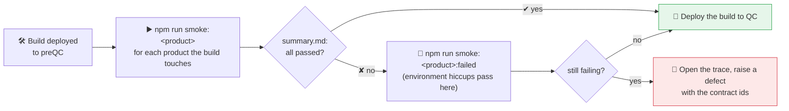
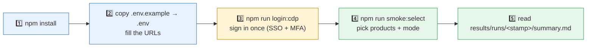
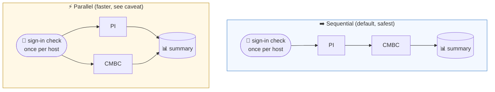
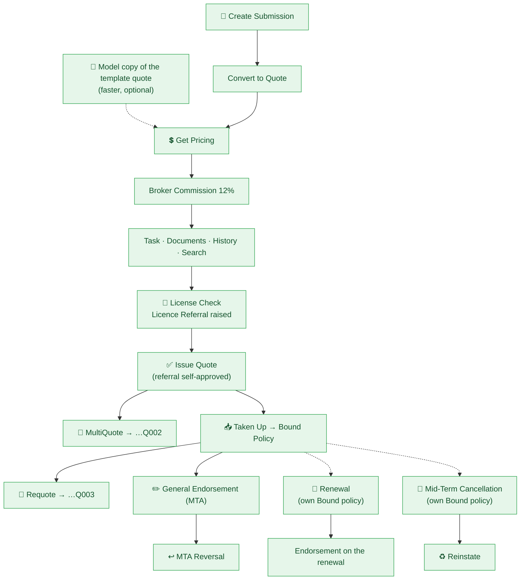
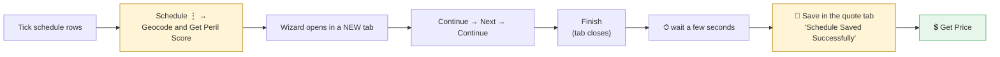
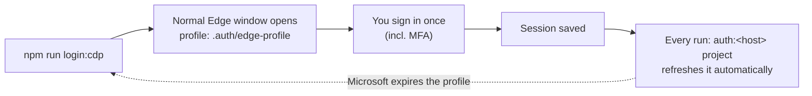
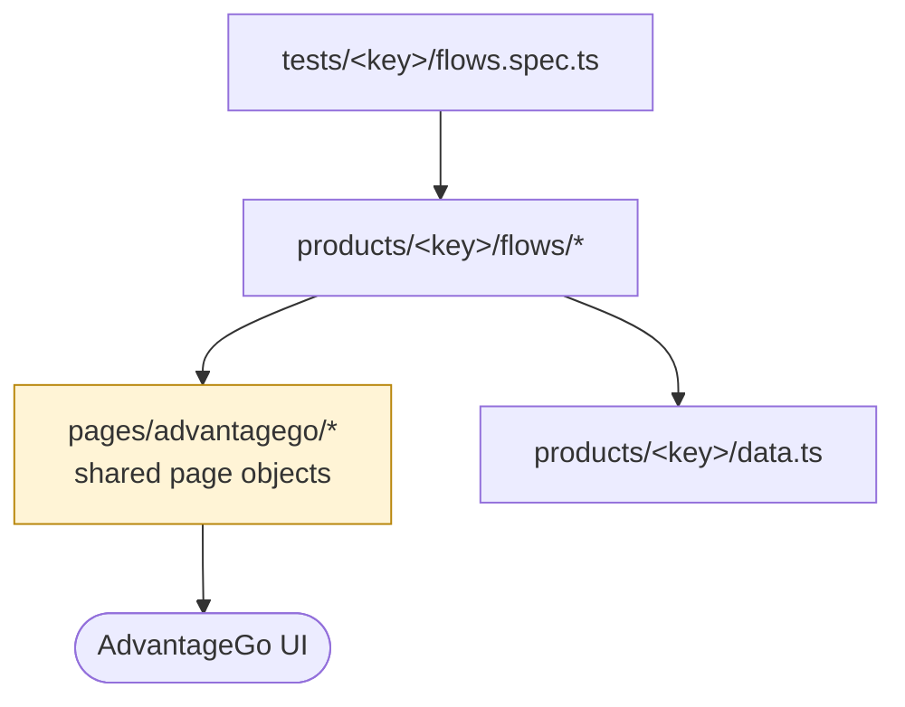

<div align="center">

# 🔥 UI Smoke Tests

### One command to smoke-test **PI · CMBC · PPP · MTP · Fleet** after every deployment


*Developed by **Deena Yadav***

[🚦 PreQC gate](#gate) · [⚡ Quick start](#quick-start) · [🧭 Which command?](#which-command) · [🔀 Sequential vs parallel](#seq-par) · [🗺️ What is covered](#covered) · [🔁 Resuming](#resume) · [🔐 Sign-in](#signin) · [🩺 Troubleshooting](#troubleshooting) · [🧱 Layout](#layout) · [🛡️ Changing tests](#changing)

</div>

---

## 📦 What is this?

A **Playwright + TypeScript** suite that replaces the manual post-deployment UI smoke check.
It drives the real AdvantageGo Underwriting screens: it creates quotes, prices, issues, takes up, endorses, renews,
cancels, reverses… and records every contract it creates.

| Product | Status | What runs |
|:--|:--:|:--|
| **PI** | ✅ Full flows | Quote → Policy → Endorsement → Reversal → Renewal → Cancellation |
| **CMBC** | ✅ Full flows | Quote (PDBI + Liability + schedule) → Policy → Endorsement → Renewal → Cancellation |
| **MTP** | ✅ Full flows | Motor Trade: Quote (PDBI + Liability + Road Risks + Legal Expenses + schedule) → Policy → Endorsement → Reversal → Mid-Term & Inception Cancellation → Renewal |
| **PPP** | ✅ Full flows | UK Property Investors Protection Plan: Quote (schedule + Survey Status + commission) → Policy → Endorsement → Reversal → Mid-Term Cancellation → Reinstate → Renewal |
| **Fleet** | ✅ Full flows | Fleet: Quote (schedule import + commission + **Experience Call before Get Price**) → Policy → Endorsement → Reversal → Mid-Term Cancellation → Renewal |

> Every product lives in **its own folder** and shares no flow code with the others, so a change to one product can never break another.

---

<a id="gate"></a>

## 🚦 PreQC gate: run before promoting a build to QC



| Step | Command / where |
|:--|:--|
| 1. Sign in once (SSO + MFA), then **close that Edge window** | `npm run login:cdp` |
| 2. Run the product the build changed (one at a time is safest) | `npm run smoke:pi` · `smoke:ppp` · `smoke:cmbc` · `smoke:fleet` · `smoke:mtp` |
| 3. Read the verdict | `results/runs/<timestamp>/summary.md` (and the console's final table) |
| 4. Something failed? Re-run only the failed + blocked tests, on the same quote/policy | `npm run smoke:<product>:failed` |
| 5. Still failing? Open the failure's trace and raise it | `npx playwright show-trace results/runs/<timestamp>/<product>/artifacts/<test>/trace.zip` |

**Go / no-go:** promote to QC when every selected product reports **passed** (✔). A **blocked** (⊘) test counts as failed: it
didn't run because a step before it failed. Send `summary.md` and `contracts.md` with the defect, because they hold every
quote, policy and MTA reference the run created.

**Latest preQC results (build R5.4)**

| Product | Tests | Last full run | Duration |
|:--|:--:|:--|:--:|
| PI | 63 ✔ · 0 ✘ | 01/11/2026 | ~34 min |
| CMBC | 64 ✔ · 0 ✘ | 31/10/2026 | ~37 min |
| MTP | 60 ✔ · 0 ✘ | 31/10/2026 | ~33 min |
| PPP | 60 ✔ (two failures fixed and re-verified afterwards) · 1 not run: the run was stopped before *Renewal - Policy Documents - Generation* | 01/11/2026 | ~35 min |
| Fleet | 74 ✔ (two failures fixed and re-verified afterwards) | 01/11/2026 | ~59 min |

> ⏱️ One product takes **30–40 minutes** (Fleet about an hour). Several products: `npm run smoke -- --products pi,ppp` runs them one after another.
> Don't use the AdvantageGo UI with the same account while a run is going: the app rotates tokens and the run gets signed out.

---

<a id="quick-start"></a>

## ⚡ Quick start



```bash
npm install
npx playwright install chromium     # or set BROWSER_CHANNEL=msedge to use the installed Edge
cp .env.example .env                # then fill in the URLs (and credentials if not SSO)
npm run login:cdp                   # a normal Edge window opens: sign in once, MFA included
npm run smoke:select                # interactive: which products? one after another, or together?
```

> 💡 A product with no `<KEY>_URL` in `.env` is **skipped, not failed**.
> Several environments? Create `.env.qa`, `.env.uat`… and run with `TEST_ENV=qa`.

---

<a id="which-command"></a>

## 🧭 Which command do I run?

| I want to… | Run this |
|:--|:--|
| 🎛️ **Be asked** which products and which mode | `npm run smoke:select` |
| 🅿️ Run **PI only** | `npm run smoke:pi` |
| 🏢 Run **CMBC only** | `npm run smoke:cmbc` |
| ➡️ Run **PI then CMBC**, one after another *(safe default)* | `npm run smoke -- --products pi,cmbc` |
| ⚡ Run **PI and CMBC at the same time** | `npm run smoke -- --products pi,cmbc --mode parallel` |
| 🌍 Run **every configured product**, one after another | `npm run smoke` |
| 🌍⚡ Run **every configured product at once** | `npm run smoke:par` |
| 👀 **Watch the browser** (recommended while debugging) | `npm run smoke -- --products pi --headed --workers=1` |
| 🎯 Run **one test** by name | `npm run smoke -- --products pi -g "Get Pricing"` |
| 🔑 Only **check / refresh the saved sign-in** | `npm run auth` |
| 📋 **List** products and whether each is configured | `npm run smoke:list` |
| 🧪 **Preview** what would run, run nothing | `npm run smoke -- --products pi,cmbc --dry-run` |
| 🔁 Re-run **only the failed + blocked tests**, every product | `npm run smoke:failed` |
| 🔁 Re-run **only the failed + blocked tests** of one product | `npm run smoke:pi:failed` (or `npm run smoke:failed -- --products pi,mtp`) |
| 🛑 **Stop at the first failing product** (sequential) | add `--fail-fast` |
| ⏭️ **Skip** the sign-in check | add `--no-auth` *(see the warning in [Troubleshooting](#troubleshooting))* |
| 🧱 Run Playwright directly (all products, shared report) | `npx playwright test` |

Shortcuts for the other products: `npm run smoke:mtp` · `smoke:ppp` · `smoke:fleet` (and `smoke:<key>:failed` for each).

> 🔁 **Failed-only re-runs** pick up exactly the tests that failed or were *blocked* last time, and run them **on that run's quote and
> policy** (its chain values in `results/state/<run>/`), so passed steps are not repeated. If that run's state is gone, the whole
> sections that failed run again instead. What to redo is kept per product in `results/last-failed/<key>.json`.

**Console output:** a header box (product, host, tests, workers, run id), one line per test (✔ passed · ✘ failed with the reason
underneath · ⊘ blocked by a failed blocking step · ○ skipped), and in a terminal a live line at the bottom with a progress bar, the
elapsed time and the test running now with what it last printed. The end shows the verdict and **total time**, a ✔ ✘ ⊘ ○ table per
section, each failure with its trace command, and the re-run command. The runner adds a table across products with the total time
of the whole run. What the tests print goes to `run.log` in each product's report folder.
Anything the runner doesn't know (`--headed`, `--workers=1`, `-g "…"`, a spec path…) is passed straight to `playwright test`.

<details>
<summary><b>All runner options</b></summary>

| Option | Meaning |
|:--|:--|
| `--products a,b` / `-p` | Product keys (order = run order in sequential mode), or `all` (default = every configured product) |
| `--mode sequential\|parallel` / `-m` | `sequential` (default): one product after another · `parallel`: all at once |
| `--sequential` / `--parallel` | shortcuts for `--mode …` |
| `--interactive` / `-i` | Ask for products and mode |
| `--fail-fast` | Sequential: stop after the first product that fails (default: carry on with the next) |
| `--no-auth` | Skip the sign-in check and use the saved session as it is |
| `--auth-only` | Only run the sign-in check / session refresh, then stop |
| `--list` | Show the products and whether they are configured, then stop |
| `--dry-run` | Show what would run, run nothing |
| `-h`, `--help` | Show the help |

</details>

---

<a id="seq-par"></a>

## 🔀 Sequential vs parallel



| | ➡️ Sequential | ⚡ Parallel |
|:--|:--|:--|
| Order | one product after another | all at the same time |
| Speed | slower | faster |
| Risk | lowest | ⚠️ PI and CMBC use the **same account on the same host**, and the app **rotates tokens**, so one can occasionally be signed out |
| Use when | normal runs, CI, anything important | the environment tolerates it |

**How it works**

- 🗂️ Each product is its **own Playwright run** with its own report folder, so one product failing never hides another's report.
  The exit code is non-zero if any selected product failed.
- 🔑 The sign-in is checked **once per login host** (PI and CMBC share one host → one check). A product whose sign-in fails is reported
  as *blocked* instead of failing every test.
- 🔒 Products running side by side share two kinds of file, both written safely: the saved sign-in (`.auth/<host>.json`, refreshed after every test) is written to a temporary file and renamed into place, so a product starting a test never reads it half-written; what to re-run is kept per product (`results/last-failed/<key>.json`). A product run on its own works exactly as before.
- 🧵 A product that needs a single browser (`<KEY>_USE_EDGE_PROFILE=1`, i.e. CMBC today) is held to **one worker**; in parallel mode the
  other products split the remaining CPU. An explicit `--workers=N` wins.

---

## 📊 Where do the results go?

```
results/runs/<timestamp>/
├── summary.md · summary.json        ← start here: one line per product
├── pi/
│   ├── html/                        ← full HTML report
│   ├── junit.xml
│   ├── contracts.md · contracts.csv ← every submission / quote / policy / MTA created, with its id and URL
│   └── artifacts/<test>/            ← screenshot, trace.zip, error-context.md of each FAILURE
└── cmbc/
    └── …same layout
```

| Want to… | Command |
|:--|:--|
| Open a product's HTML report | `npx playwright show-report results/runs/<timestamp>/pi/html` |
| Replay a failure step by step | `npx playwright show-trace results/runs/<timestamp>/pi/artifacts/<test>/trace.zip` |
| Open the last *direct* `npx playwright test` run | `npm run report` |

Failures keep a **trace** (a screenshot of every step), plus any console errors and 5xx API calls the page made.

---

<a id="covered"></a>

## 🗺️ What is covered

Legend: ✅ automated &nbsp;·&nbsp; 🟡 automated, not yet proven end-to-end &nbsp;·&nbsp; ⬜ not written yet &nbsp;·&nbsp; 🔒 backend evidence only (not UI-testable)

### 🅿️ PI — `tests/pi/flows.spec.ts`



| Checklist row | Status | What the test does |
|:--|:--:|:--|
| Create Submission · Convert to Quote · Get Pricing | ✅ | New Submission → details → Convert to Quote → add risk section → Get Price ("Price is returned…") |
| Get Commission | ✅ | PI isn't eligible for ⋮ → Get Commission, so the defaulted Broker Commission row gets its Override % (12%) in DETAILS → Commission (test: Add Broker Commission) |
| Quote create task | ✅ | Creates an *Underwriting Referral – PI* task, then completes it (card ⋮ → Complete) |
| Quote Documents – Generation & Download | ✅ | Automatic Wording terms, PDF upload, download (byte-compared); *Generate Document* only on an issued quote |
| Quote History · Links · Tasks · Licence | ✅ | Timeline, Links, Tasks and Licence tabs |
| Search / Advance Search | ✅ | Keyword search + Risk-Quote advanced filter |
| License Check – Task Generation | ✅ | Next Stage → Issue Quote → Authority Limit warning → Acknowledge → Licence Referral task |
| Issue Quote | ✅ | Referral forwarded to the signed-in user and approved from History → Tasks, then Issue Quote → *Quoted*. `LICENCE_SELF_APPROVE=0` waits for a real approver (`APPROVAL_WAIT_MINUTES`) |
| **MultiQuote** | ✅ | On the **issued** quote: ⋮ → *Convert to Multi Quote* → Save → toast "MultiQuote created from Quote" → next quote of the same risk (**…Q002**, Provisional). The source quote stays Quoted |
| Quote Taken up → Policy | ✅ | Four tests: **Quote Taken up** (⋮ → Taken Up reaches the unsaved Policy Conversion) · **Policy Conversion** (Taken Up again → Save: policy created, quote Taken Up) · then in the *Policy* section **Confirm Cover** (**Bound**) · **Policy Documents - Generation** (every policy document *Completed*; an *In Error* document fails this test alone, with the service's error text) |
| **Requote** | ✅ | ⋮ → *Requote* is greyed out until the quote is **Taken Up** → "open tasks, continue?" → Ok → Save → new version (**…Q003**) |
| MTA – GE Pricing / endorsement | ✅ | One test per step: `MTA - GE - Endorsement Quote` (⋮ General Endorsement → Save, …Q00n) → (Fleet: `MTA - GE - Experience Call`) → `MTA - GE - Get Pricing` → `MTA - GE - Issue Quote` (and its documents generated) → `MTA - GE - Take Up Endorsement` (re-price → Policy Conversion) → `MTA - GE - Confirm Endorsement` (Bound) → `MTA - GE Documents - Generation` |
| **MTA – Reversal** | ✅ | On the endorsed policy: **Endorsement grid → the row's ⋮ → Reverse → Yes**. Checks header = *Reversed*, row *Bound → Reversed*, endorsement 000 (Original) still *Bound* |
| Renewals | ✅ | One test per operation: `Renewal - Base - Model Quote` → `Base - Get Pricing` → `Base - Issue Quote` → `Base - Policy Conversion` → `Base - Confirm Cover` (its own Bound policy, made the way the main one is) → `Renew Quote` → `Get Pricing` → `Issue Quote` → `Quote Taken up` → `Policy Conversion` → `Confirm Cover` → `Policy Documents - Generation` → `Renewal - MTA - GE Pricing and Confirm Endorsement` → its `GE Documents - Generation` |
| Mid-Term Cancellation + Reinstate | ✅ | One test per step: `MTC - …` (its own Bound policy: Model Quote → Get Pricing → Issue Quote → Policy Conversion → Confirm Cover) → `MTA - Mid Term Cancellation Policy` (⋮ Mid-Term Cancellation → Save, …/MTA001) → `- Get Pricing` → `- Confirm Cancellation` → `MTA - Mid Term Cancellation Documents - Generation` → `Reinstate Policy` (⋮ Reinstate Contract → Save; the backend completes it, the outcome is checked). MTP and CMBC: `IC - …` → `MTA - Inception Cancellation Policy` → `- Get Pricing` → `- Confirm Cancellation` → its documents, the same way |
| Decline / Not Taken Up / Mark as Lost | 🟡 | Each on its own ⋮ → Model copy (each is an end state of a quote). **Decline**. **Not Taken Up** and **Mark as Lost**: `<name> - Model Quote` → `<name> - Get Pricing` → `<name> - Issue Quote` → `<name>`, which checks the status (*Not Taken Up* / *Closed · Lost*) and the "This risk was marked as … The reason recorded was …" notice (reported). The reason is the first one the list offers. The actions themselves are proven (31/10 run); the final check was corrected after it |
| Inception Cancellation | ⬜ | Not written (cancellations are New Business only) |
| Data Lake – Quote / Pricing / MTA / Schedule / ALS | 🔒 | Backend payload check |

<a id="cmbc"></a>

### 🏢 CMBC — `tests/cmbc/flows.spec.ts`

> [!IMPORTANT]
> **Geocoding + Peril Scoring is mandatory before Get Price** on *every* CMBC transaction (New Business, Renewal, endorsement…).
> Without it Get Price fails with *"The Geocoding for all schedule items have not been done"*.
> Quotes copied with ⋮ → Model and endorsement quotes already carry geocoded items; a **renewal quote's schedule does not**, so the
> flow runs `priceQuote(page, url, { geocodeFirst: true })` first.



| Checklist row | Status | Notes |
|:--|:--:|:--|
| Submission → Convert to Quote (PDBI + Liability child sections) | ✅ | Three tests: `Create Submission` → `Convert to Quote` → `Convert to Quote with PDBI and Liability child sections` (offering *Standard CMBC*, sections, details, exposures and a typed-in Selected % per section, saved together: the app keeps sections in memory only and refuses the Save while any of it is empty) → `Get Commission` (⋮ Get Commission on the saved quote). That quote is the model |
| Create working quote from the reference model | ✅ | ⋮ → Model |
| Insert schedule with geocoding and peril score | ✅ | Imports `CMBC/CMBC_Schedule_Import.xlsx` |
| Get Commission · Get Pricing | ✅ | |
| Quote Terms and document upload / download | ✅ | |
| Search / Advance search Quote | ✅ | |
| Issue Quote · Taken up quote | ✅ | Next Stage first (Get Price only exists in *UW Review & Process*) |
| General endorsement → take-up → MTA pricing | ✅ | |
| Mid-Term Cancellation – Pricing and Reinstate | ✅ | |
| Renewals – Pricing | 🟡 | Geocoding is a test of its own before every Get Pricing on a copied schedule: `Renewal - Base -`, `Renewal -`, `MTC -` and `IC - Geocoding and Peril Scoring` (Schedule ⋮ → Geocode and Get Peril Score → wizard → Save), then `… - Get Pricing` prices only. Not yet run |
| Requote · Multi-Quote | 🟡 | Same tests as MTP (MultiQuote after Issue Quote, Requote after Policy Conversion); not yet run |
| MTA – Reversal · MTA – Inception Cancellation Policy | 🟡 | CMBC's own copies of MTP's steps (+ `MTA - Inception Cancellation Documents - Generation`); not yet run |
| Documents/datalake payload · Data lake · ALS & server-folder payloads | 🔒 | Backend evidence |

<a id="mtp"></a>

### 🚗 MTP (Motor Trade) — `tests/mtp/flows.spec.ts`

Own folder `src/products/mtp/` (data, `MtpSectionsPage`, `flows/quote.ts`, `flows/policy.ts`); it shares only the low-level pages with the other products.
Env: `MTP_URL`, `MTP_SCHEDULE_IMPORT`, plus the `MTP_*` resume URLs.

| Checklist row | Status | Notes |
|:--|:--:|:--|
| Convert to Quote (PDBI, Liability, Road Risks, Legal Expenses) | ✅ | Three tests: `Create Submission` → `Convert to Quote` → `Convert to Quote with PDBI, Liability, Road Risks and Legal Expenses` (sections, details, Get Commission and Selected %, saved together: the sections stay in memory until that Save). Product *Motor Trade*. Needs the Risk Validation answer *Yes*, the analysis codes (Section G / 45 / 45.1 / 45.11 / 4511100) and the Claims History fields. The offering (SME) is defaulted, **the risk sections are not**: the test adds them |
| Create working quote from the reference model | ✅ | ⋮ → Model |
| Insert schedule with geocoding and peril score | ✅ | Imports `MTP/MTP_Schedule_Import.xlsx` (the file must be saved by Excel: the app's own export has non-standard cell references and the importer reads it as empty) |
| Get Commission · Get Pricing | ✅ | Every section is listed as *not rated* in the commission dialog; the test accepts it. Next Stage answers with a warnings banner (*Selected Product Hazard*) that is acknowledged. **Get Price is only offered from the 2nd stage, UW Review & Process**, so Next Stage comes first. **Geocoding + Peril Score is mandatory before Get Price**: when the app answers *"The Geocoding for all schedule items have not been done"* the test runs *Geocode and Get Peril Score* and prices again (`getPriceGeocodingIfMissing`). Each product has its own stages and operations, which is why MTP keeps its own flows |
| Quote Terms and document upload / download · Search / Advance search | ✅ | |
| Issue Quote · Multi-Quote · Taken up quote · Requote | ✅ | |
| General endorsement → take-up → MTA pricing · MTA – Reversal | ✅ | |
| Mid-Term Cancellation – Pricing and Reinstate | ✅ | |
| Renewals – Pricing | ✅ | Own Bound policy → Renew – Quote → **CTA rationale** (Details → Premium, mandatory once the renewal inherits a CTA) → price (geocoding done first when missing, as above) → issue → take up → Bound renewal policy |
| MTA – Inception Cancellation Policy – Pricing | ✅ | Own Bound policy → ⋮ Inception Cancellation → Save (Confirm *"Do you wish to confirm the change?"*, then Ok on *"Effective dates of the Child components…"*) → Get Price → Confirm Cancellation → documents |
| Documents/datalake payload · Data lake · ALS & server-folder payloads | 🔒 | Backend evidence |

> The backend document service sometimes ends one policy document **"In Error"**. The *Taken up quote* test reports it; set-up policies (for cancellation / renewal) do not assert documents, so the later policy tests still run. (An Inception Cancellation's documents ended "In Error" in two earlier runs and completed in the latest one, so it is intermittent.)

<a id="ppp"></a>

### 🏘️ PPP (UK Property Investors Protection Plan) — `tests/ppp/flows.spec.ts`

Own folder `src/products/ppp/` (data, `PppSectionsPage`, `flows/quote.ts`, `flows/policy.ts`). Env: `PPP_URL`, `PPP_SCHEDULE_IMPORT`, plus the `PPP_*` resume URLs.

| Checklist row | Status | Notes |
|:--|:--:|:--|
| Convert to Quote | ✅ | Needs Business Type, *All buildings constructed after 01/01/2000?* = Yes and Claims History years = 0 |
| Create working quote · Insert schedule · Get Commission · Get Pricing | ✅ | No fixed reference quote: the quote created from the submission (offering *Standard PPP* → PPP risk section) is the model, every other PPP quote is a ⋮ → Model copy of it. The schedule (`PPP/PPP_Schedule_Import.xlsx`) already carries **General Risk Detail → Is A Survey Required? = Yes, Survey Status = Survey Completed**, so every quote has it from the start. The import has an extra *Define Mapping* notice. Commission: Broker Commission row 12% (added with + when missing) |
| Quote create task · Documents · History · Search | ✅ | Task type *Underwriting Referral - PPP*; the assignee (`PPP_TASK_ASSIGNEE`, default Deena Yadav) is typed into the list to filter it; the Complete click is repeated because it sometimes has no effect |
| Issue Quote · Multi-Quote · Taken up quote · Requote | ✅ | MultiQuote needs an issued quote that is **not yet Taken Up**, and clicks Ok on the "open tasks" dialog |
| General endorsement → take-up → MTA pricing · MTA – Reversal | ✅ | GE Get Pricing reports the app's error toast when no price comes back, and tries once more |
| Decline · Not Taken Up · Mark as Lost · Renewals | ✅ | Renewal: the *CTA rationale* is filled only when the renewal shows the field |
| Mid-Term Cancellation | ✅ | Reason code + **Effective To = today** (Effective From left as the form pre-sets it), then Save |
| Reinstate Policy | ✅ | Works with the cancellation above (with Effective From = today the backend halted at *PPPV2RECPolicyReview Stage – Pricing is Failed*). A cancellation can be reinstated **only once**, even after an error, so a failed-only re-run builds a fresh Bound policy and cancels it first |
| Data lake | 🔒 | Backend evidence |

### 🧩 Fleet

Own folder `src/products/fleet/` (data, `FleetSectionsPage`, `flows/quote.ts`, `flows/policy.ts`). Env: `FLEET_URL`, `FLEET_SCHEDULE_IMPORT`. No fixed reference quote: the quote created from the submission (inception today − 10 days; offering *Vantage Fleet* → FLEET section + covers → schedule import → commission) is the model, and every other Fleet quote is a ⋮ → Model copy of it.

| Checklist row | Status | Notes |
|:--|:--:|:--|
| Get Commission | ✅ | ⋮ → Get Commission (Fleet is eligible) |
| Get Experience Call | ✅ | *Number of years claims experience* (Details → Claims Experience Analysis → Years Claims Experience) is set above 0 (`fleetClaims.years`), and the pricing inputs (Risk Postcode, UW Period Choice, UW ACCPV Pick) are filled in **one Details load and Save**, then Next Stage, then ⋮ → Experience Call. Every Fleet chain that prices has its own `… - Experience Call` test before `… - Get Pricing` (main quote, Not Taken Up / Mark as Lost copies, Renewal base and renewal quote, Cancellation base, General Endorsement), so Get Pricing only prices and no quote makes the call twice |
| Add schedule by import · CDL call | ✅ | `Insert schedule by import (vehicle lookup)`: SCHEDULE → Import, *With Vehicle Lookup* (the CDL call enriches each registration) |
| Get Claims | ✅ | `Fleet - Schedule and Claims` › `Get Claims`: ⋮ → Get AXA Claims, the claims connector must answer OK. Not yet run |
| Add / Update / Delete Schedule manually · Export | ✅ | Same section, on a Model copy of its own: + Add New → registration → Save · the registration changed → Save · ticked → − Delete → Ok · Export → .xlsx. The grid can open with another row already ticked, so Delete unticks every other row first |
| Create Individual Party / Organisation | – | Not part of the product smoke |
| Data lake | 🔒 | Backend evidence |

## 📐 Conventions (all five products)

- **No fixed reference quote** in any product: the quote created from the submission in each product's `<Product> - Quote` chain is the model, and every other quote of that product is a ⋮ → Model copy of it (built first when a worker has none).
- **Inception date** = today − 10 days, for every new submission and every Model-copy quote (`src/support/dates.ts`). A General Endorsement
  (Effective From = inception + 10 days) therefore starts today.
- **Mid-Term Cancellation** takes effect **today**: `effectiveFrom` in each product's cancellation data. Exceptions: **PPP** sets `effectiveTo` = today, which its reinstatement needs, and **Fleet** sets Effective To = inception + 10 days, because its form fixes Effective From.
- **Commission:**
  - **PI and PPP** aren't eligible for ⋮ → *Get Commission*. DETAILS → Commission: no Broker Commission row → one is added with **+**
    and given 12%; a defaulted row with a blank % → 12%; a row that already has a % → left as it is. Test name: `Add Broker Commission`.
  - **Fleet, CMBC and MTP**: ⋮ → *Get Commission*, then 12% for every row the connector left empty. If Get Commission **errors**, the
    Broker Commission is added by hand (as for PI) so the chain carries on, and the `Get Commission` test fails with the connector's error.
- **Warnings:** every product acknowledges any warnings banner (ACKNOWLEDGE) and carries on.
- **A failure does not stop the chain.** The flow chains run in order (`test.describe.configure({ mode: 'default' })`, not
  `describe.serial`): after a failed test the next one still runs, in a fresh worker that reads the chain's values (quote URL, policy URL,
  model quote …) back from `results/state/<run>/` (`src/support/runState.ts`).
- **Blocking operations** (Convert to Quote, schedule + geocoding/peril score, Get Price, Issue Quote, Quote Taken up, Policy Conversion, Confirm Cover, Confirm
  Endorsement): a test that cannot be done without one names it with `steps.needs('Get Pricing')` and is skipped as
  *Blocked: "Get Pricing" failed (…)* when that step failed in this run, instead of running into a timeout. Blocks pass down the chain
  (no Issue Quote → no Taken Up → no endorsement → no reversal). A step that was skipped or did not run (e.g. resumed with
  `<KEY>_QUOTE_URL`) blocks nothing.
- **Test groups:** `<Product> - Submission and conversion | Quote | Quote lifecycle | Policy | Cancellation | Renewal`, tagged `@flow` and `@<key>-flow`
  (`@smoke` is only for the quick page checks). Same step ⇒ same test name in every product (`MultiQuote`, `Requote`, `Renewals`,
  `Quote Taken up`, `Policy Conversion`, `Confirm Cover`, `Policy Documents - Generation`, `MTA - GE - <step>`, `MTA - Mid Term Cancellation Policy`, `Reinstate Policy`, `MTC - <step>`,
  `Renewal - <step>`…).
- **Documents are their own tests.** Every transaction that generates documents (policy, endorsement, cancellation, renewal policy,
  renewal endorsement) is followed by a `… Documents - Generation` test. A document the service could not generate (*In Error*) fails
  that test alone, with the service's error text, and blocks nothing: the reversal, reinstatement and renewal steps still run.
- **Contract records** are prefixed with the product (`Fleet Endorsement Quote`, `PPP Mid-Term Cancellation (MTA)`…); env variables are `<KEY>_*` (upper case).
- Shared test PDF: `src/assets/smoke-doc.pdf`.

---

<a id="resume"></a>

## 🔁 Resuming a long run (environment variables)

A full PI run takes ~25 minutes and a **session can expire mid-run**. Rather than start over, point a test at records that already exist:

| Variable | Resumes… |
|:--|:--|
| `PI_QUOTE_URL` | quote-level steps alone on an existing quote (e.g. `-g "Get Pricing"`) |
| `PI_POLICY_URL` | the policy rows (endorsement, reversal…) on an existing **Bound** policy |
| `PI_ENDORSEMENT_URL` · `PI_ENDORSED_POLICY_URL` | an endorsement already started / finished (one endorsement per policy at a time) |
| `PI_RENEWAL_BASE_POLICY_URL` · `PI_RENEWAL_QUOTE_URL` · `PI_RENEWAL_POLICY_URL` · `PI_RENEWAL_ENDORSEMENT_URL` | each stage of the renewal |
| `PI_CANCEL_POLICY_URL` · `PI_CANCEL_MTA_URL` · `PI_REINSTATE_MTA_URL` | each stage of cancel / reinstate |
| `CMBC_…` · `MTP_…` | the same idea for CMBC and MTP (`CMBC_QUOTE_URL`, `MTP_POLICY_URL`, `MTP_ENDORSEMENT_URL`, `MTP_ENDORSED_POLICY_URL`, `MTP_CANCEL_*`, …) |

```bash
# example: carry on from a Bound policy, run only the policy rows
PI_POLICY_URL=https://<host>/ui/Policy/Edit/117670 npm run smoke -- --products pi --headed --workers=1 -g "PI - Policy"
```

---

<a id="signin"></a>

## 🔐 Signing in (SSO + MFA)



- `npm run login:cdp -- ppp` picks the product whose host to sign in to, when products are on different hosts.
- `npm run auth` runs just the refresh step.
- `npm run login` (Playwright's own browser) gets closed by the SSO redirect on some machines — use `login:cdp` if that happens.
- ⚠️ **Never run two test / explore sessions at once**: the app rotates tokens and the second one gets logged out.

---

<a id="troubleshooting"></a>

## 🩺 Troubleshooting

| Symptom | Cause | Fix |
|:--|:--|:--|
| *"browser has been closed"* at the SSO callback | The exported session file was invalidated (CMBC runs use the live Edge profile and **rotate the token**) | Run **without** `--no-auth` after a CMBC run, or `npm run login:cdp` |
| Tests fail with *"Logging in…"* / Microsoft login pages in the middle of a long run | The SSO session expired | Re-run the remaining tests with `npm run smoke:failed` (or the [resume variables](#resume)) |
| A fresh page lands on the Dashboard, or stays blank on *"Refreshing Token"*, late in a long run | The app's tokens (about an hour) outlived the session saved at the start; the app signs in again by itself (`/ui/login?code=…`) and loses the link | Handled: after every test that ends signed in, its session is saved back (`sessionKeeper` fixture), so the next test starts with fresh tokens; the documents page also opens its link again up to 3 times |
| A page renders blank, or the deep link lands on the Dashboard | Slow host | Handled automatically: the page is opened again up to 3 times |
| Sign-in check fails with *"launchPersistentContext: Target page, context or browser has been closed"* (the hint about installing a browser is misleading) | The `npm run login:cdp` Edge window is still open and locks `.auth/edge-profile` | Handled: the runner closes that window (only that one) before the check. If it still happens, close it yourself and run again |
| Sign-in check fails, Microsoft login page in the trace | The saved session expired | `npm run login:cdp`, sign in, close Edge, run again |
| A failed-only re-run of **Reinstate Policy** times out | That cancellation was already reinstated once (an errored reinstatement counts) | Handled for PPP (it builds a new policy). Other products: run the whole Cancellation section again (`-g "Cancellation"`) |
| Console has no colours | Output is piped / not a terminal | Set `FORCE_COLOR=1` |
| *"Profile already in use"* | A login Edge window is still open | Close it (the runner kills only Edge windows using `.auth/edge-profile`) |
| CMBC Get Price: *"The Geocoding … have not been done"* | Schedule not geocoded | See the [CMBC geocoding rule](#cmbc) |
| Policy documents end **"In Error"** | Backend document service, not the test | Check the doc service; the test fails fast instead of waiting |
| Save / Get Price / Issue shows a warnings banner | App wants an acknowledgement | Handled: the **ACKNOWLEDGE** link finishes the action |
| *Issue Quote* waits forever | The Licence Referral needs a Level 2/3 approver | The suite self-approves; `LICENCE_SELF_APPROVE=0` waits for a real person |

---

<a id="other-env"></a>

## 🌍 Running against another environment (e.g. QC)

The code has no host hard-wired: every product reads `<KEY>_URL` from the env file.

1. Create `.env.qc` next to `.env` with the QC URLs (`PI_URL=https://<qc-host>` …). Anything it leaves out is taken from `.env`.
2. Run with `TEST_ENV=qc`, e.g. in PowerShell `$env:TEST_ENV='qc'; npm run smoke:pi`.
3. Sign in to that host once: `npm run login:cdp -- pi` (each host has its own saved session).

> ⚠️ The test data is preQC data: insured *Anjali Insured demo*, agency *Anjali,Intermediary* (7401474), the underwriters, the
> task assignee and the schedule files in `<PRODUCT>/`. Check they exist in the target environment. If they don't, change them in
> `src/products/<key>/data.ts`, or in an env variable where one exists (`<KEY>_TASK_ASSIGNEE`, `<KEY>_SCHEDULE_IMPORT`, `<KEY>_TASK_TYPE`).

---

<a id="changing"></a>

## 🛡️ Changing or adding tests

Read **[CONTRIBUTING.md](CONTRIBUTING.md)** before changing anything. In short:

- A change stays **inside its product's folder** (`src/products/<key>/`, `tests/<key>/`). Changes to the shared page objects in
  `src/pages/advantagego/`, the runner or the reporters need the owner's review, because they affect all five products.
- Test data goes in `data.ts`, never inline in a spec. Locate by label/role (the Kendo helpers), never by generated ids. No fixed sleeps.
- `npm run check` (typecheck + test listing) must pass, and the changed product must pass a full run on preQC, before the change is merged.

---

<a id="layout"></a>

## 🧱 Project layout

```
src/
├── products/
│   ├── index.ts              registry: the list of products (add yours here)
│   ├── types.ts              ProductConfig + defineProduct()  (env-driven: <KEY>_URL, <KEY>_USER, <KEY>_<ANYTHING> via product.env())
│   ├── platforms/advantagego.ts   login, home page and page checks shared by every AdvantageGo product
│   ├── pi/      index.ts · data.ts · PiSectionsPage.ts · flows/quote.ts · flows/policy.ts
│   ├── cmbc/    index.ts · data.ts · CmbcSectionsPage.ts · flows/quote.ts · flows/policy.ts   (own copies: nothing shared with PI)
│   ├── mtp/ ppp/ fleet/      full flows, same layout (data, <Key>SectionsPage, flows/)
├── pages/advantagego/        low-level page objects (quote, policy, search, documents, grids…) — the ONLY code products share
├── config/                   env.ts · auth.ts (session files, one login per host)
├── smoke/registerSmokeSuite.ts   the generic checks every product gets
└── fixtures/ · support/      diagnostics fixture · contracts table
tests/<key>/                  smoke.spec.ts + flows.spec.ts for each product
scripts/run-smoke.mjs         the runner · scripts/login-cdp.mjs  SSO sign-in helper
```



<a id="add-product"></a>

### ➕ Adding a product

1. **Config** — `src/products/<key>/index.ts`:
   `export const ppp = defineProduct('ppp', 'PPP', { ...advantageGo, /* overrides */ })` (already scaffolded for ppp, fleet).
2. **Register** it in `src/products/index.ts`.
3. **Enable** it by setting `<KEY>_URL` (and `<KEY>_USER` / `<KEY>_PASSWORD` if it doesn't use SSO) in `.env`.
   That alone turns on the generic page checks, and `npm run smoke:<key>` / `--products <key>` start working.
4. **Flows** — keep them *all inside the product's folder*: test data in `data.ts`, steps in `flows/quote.ts` and `flows/policy.ts`,
   product-specific page objects next to them (extend `QuoteSectionsPage`), specs in `tests/<key>/flows.spec.ts`.
   Copy PI's or CMBC's `flows/` as the starting point and change it freely. Read product settings with `<product>.env('<NAME>')`.

<details>
<summary><b>➕ Adding a page check (no code)</b></summary>

```ts
// src/products/fleet/index.ts
export const fleet = defineProduct('fleet', 'Fleet', {
  loggedInIndicator: '#user-menu',
  buildVersion: '.footer-version',
  pages: [
    { name: 'Dashboard', path: '/dashboard', expect: 'role=heading[name="Dashboard"]' },
    { name: 'Vehicles',  path: '/vehicles',  expect: 'table' },
  ],
});
```

Use `npm run codegen -- https://fleet-qa.example.com` to record clicks and get reliable selectors.

</details>

---

<div align="center">

**Quick reminder** &nbsp;·&nbsp; `npm run smoke:select` to choose &nbsp;·&nbsp; `--headed --workers=1` to watch &nbsp;·&nbsp; `results/runs/<timestamp>/summary.md` for the answer

</div>
